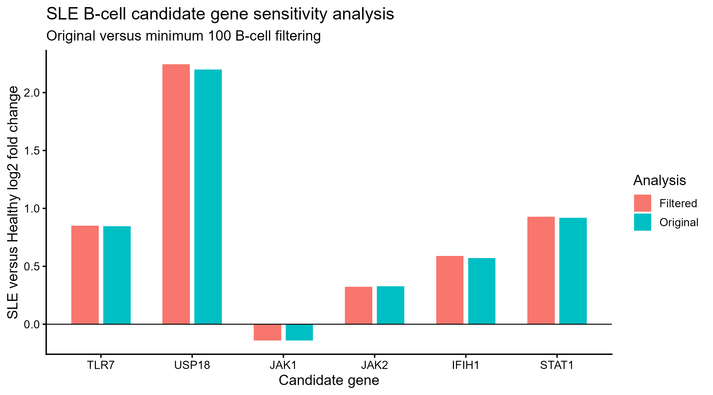

# SLE-RNA-Therapeutic-Discovry
AI-guided RNA therapeutic target discovery for Systemic Lupus Erythematosus using single-cell transcriptomics
# Machine Learning-Based SLE Therapeutic Target Discovery Using Single-Cell Transcriptomic Features

# SLE RNA-seq Therapeutic Target Discovery

## Overview

This project develops an exploratory computational framework for identifying and prioritizing potential therapeutic targets in **systemic lupus erythematosus (SLE)** using single-cell RNA sequencing, differential-expression analysis, biological feature engineering, and machine learning.

The study integrates two complementary approaches:

1. **Single-cell and pseudobulk transcriptomic analysis** to investigate disease-associated B-cell expression changes and interferon-related pathways.
2. **Machine-learning-based prioritization** to explore which engineered transcriptomic features contribute to computational therapeutic-candidate scores.

The results are intended to generate hypotheses for future experimental investigation, not to establish clinically validated drug targets.

## Research Objectives

- Identify differentially expressed genes in SLE versus healthy B cells.
- Investigate enriched immune and interferon-associated biological processes.
- Prioritize biologically relevant candidate genes for further investigation.
- Assess the robustness of selected candidates using donor-aware sensitivity analysis.
- Explore feature selection and machine learning for computational target prioritization.
- Establish a foundation for independent biological and functional validation.

## Dataset

**Public dataset:** GEO accession [GSE174188](https://www.ncbi.nlm.nih.gov/geo/query/acc.cgi?acc=GSE174188)

The B-cell pseudobulk analysis included:

| Dataset | Original analysis | Filtered sensitivity analysis |
|---|---:|---:|
| Pseudobulk samples | 284 | 259 |
| Independent donors | 220 | 202 |
| Genes tested | 7,917 | 7,712 |

The sensitivity analysis excluded samples containing fewer than 100 B cells.

## Computational Workflow

1. Single-cell RNA-seq data processing and B-cell analysis
2. Pseudobulk count aggregation
3. Batch-adjusted, donor-aware differential-expression analysis
4. Gene Ontology Biological Process enrichment
5. Interferon-associated candidate gene assessment
6. Biological feature engineering and computational target ranking
7. Repeated LASSO-based stability feature selection
8. Logistic regression and random forest model training
9. Feature importance interpretation
10. Low-cell-count filtering sensitivity analysis

## Differential-Expression Analysis

SLE and healthy B-cell pseudobulk samples were analyzed using a limma-voom framework, with batch adjustment and donor-level correlation to account for repeated samples.

### Principal Results

- **7,917 genes** tested in the original analysis
- **1,586 differentially expressed genes** at Benjamini–Hochberg FDR < 0.05
- **94 enriched Gene Ontology Biological Processes**
- **27 enriched GO terms** matching immune, antiviral, interferon, or defense-related terminology
- **59 interferon-associated genes** identified from enriched interferon-related GO terms

These findings support altered interferon-associated transcriptional signaling in SLE B cells.

## Six Candidate Genes

Six genes were selected for focused biological and therapeutic assessment.

| Gene | Original log2FC | Original FDR | Biological relevance |
|---|---:|---:|---|
| TLR7 | +0.847 | 2.55e-08 | Innate immune receptor |
| USP18 | +2.199 | 5.21e-16 | Negative regulation of interferon signaling |
| JAK1 | -0.140 | 5.16e-07 | Cytokine and interferon-associated signaling |
| JAK2 | +0.329 | 3.23e-04 | Cytokine-associated signaling |
| IFIH1 | +0.571 | 9.58e-11 | MDA5-mediated innate immune sensing |
| STAT1 | +0.920 | 4.24e-17 | Interferon-responsive transcriptional regulation |

Positive and negative log2 fold changes indicate higher or lower transcript abundance in SLE B cells relative to healthy controls, respectively.

Differential expression alone does not establish whether a gene should be inhibited, activated, or otherwise therapeutically modulated. In particular, increased USP18 expression may represent compensatory negative feedback.

## Sensitivity Analysis

To test the robustness of the six candidate genes, pseudobulk samples with fewer than 100 B cells were excluded and the donor-aware, batch-adjusted model was refitted.

| Gene | Original log2FC | Filtered log2FC | Filtered FDR |
|---|---:|---:|---:|
| TLR7 | +0.847 | +0.850 | 8.58e-08 |
| USP18 | +2.199 | +2.244 | 2.95e-14 |
| JAK1 | -0.140 | -0.140 | 5.76e-07 |
| JAK2 | +0.329 | +0.324 | 3.66e-04 |
| IFIH1 | +0.571 | +0.589 | 1.60e-11 |
| STAT1 | +0.920 | +0.928 | 9.15e-16 |

**Sensitivity analysis findings:**

- All six candidates remained statistically significant at FDR < 0.05.
- All six retained their original expression directions.
- The largest absolute change in estimated log2 fold change was **0.0446**.

These findings demonstrate robustness to this particular low-cell-count filtering decision. They do not constitute independent-cohort validation.

### Six-Gene Sensitivity Analysis Figure

The following figure compares the original and filtered
log2 fold changes for six candidate genes.

All six genes retained their expression directions
and remained significant (FDR < 0.05) after filtering.

**Supporting files:**

- [Sensitivity analysis results (CSV)](results/B_cell_six_target_filtering_sensitivity.csv)
- [Reproducible R analysis script](single_cell/12_B_cell_filtering_sensitivity.R)
- [Scientific conclusions](results/B_cell_final_scientific_conclusions.txt)
- [R package requirements](R_PACKAGES.md)

## Machine Learning and Feature Engineering

The machine-learning component explores computational target prioritization using engineered features derived from transcriptomic analyses.

Features include:

- Differential-expression magnitude
- Expression prevalence
- Cluster distribution
- Cell-type support
- B-cell specificity
- Additional derived disease- and expression-related scores

### Stability-Based Feature Selection

Repeated LASSO regularization was used to assess feature-selection stability. The workflow repeatedly samples 80% of the training dataset, applies LASSO feature selection, and records selection frequencies.

Features with high selection frequencies were considered stable within this computational setup.

### Models

The exploratory machine-learning workflow includes:

- Logistic regression
- Random forest

Previously recorded ROC-AUC results were:

| Model | Recorded ROC-AUC |
|---|---:|
| Logistic regression | 1.000 |
| Random forest | 0.998 |

**Important interpretation:** The classification labels were defined from an existing computational therapeutic-target score, while the model predictors include related engineered features. Therefore, these high ROC-AUC values reflect prediction of the derived scoring labels and must not be interpreted as independently validated therapeutic-target prediction performance. Potential information leakage and validation design also require further assessment.

## Repository Structure

The repository includes the following main directories:

| Directory | Purpose |
|---|---|
| `R/` | R-based analysis components |
| `single_cell/` | Single-cell and pseudobulk analysis scripts |
| `machine_learning/` | Feature selection and model training |
| `models/` | Saved model objects |
| `data/` | Selected analysis datasets |
| `results/` | Computational results and summary tables |
| `visualization/` | Visualization scripts |
| `scripts/` | Supporting analysis scripts |

Selected summary results and figures from the completed sensitivity analysis are intended to be added to the repository.

## Limitations

- Results originate from a public observational transcriptomic dataset.
- The filtering sensitivity analysis reuses the original dataset and is not independent validation.
- Batch effects, medication exposure, and other potential clinical confounders may influence observed expression patterns.
- Flare-versus-managed subgroup comparisons are limited by substantial batch confounding.
- Transcript abundance does not directly measure protein abundance or signaling activity.
- Machine-learning performance against score-derived labels does not establish performance against experimentally validated drug-target outcomes.
- No functional perturbation experiment or therapeutic efficacy study was conducted.

## Future Research

Future work should focus on:

1. Independent validation in additional SLE cohorts.
2. B-cell-subset-specific analysis of candidate expression.
3. Protein-level and signaling-pathway measurements.
4. Functional perturbation of prioritized candidates.
5. Integration of human genetics, druggability, and safety evidence.
6. Evaluation against independently established biological or therapeutic outcomes.

## Conclusion

This computational study identified extensive B-cell transcriptional differences between SLE and healthy samples, including enrichment of interferon-associated biological processes.

Six biologically relevant candidate genes—**TLR7, USP18, JAK1, JAK2, IFIH1, and STAT1**—retained their differential-expression significance and direction following low-cell-count filtering.

The results provide a reproducible starting point for hypothesis-driven SLE therapeutic research, subject to independent and experimental validation.

## Research Status

**Completed:** Exploratory B-cell differential-expression analysis, pathway enrichment, candidate prioritization, and filtering sensitivity analysis.

**Future work:** Independent validation, functional experiments, and further evaluation of machine-learning methodology.

